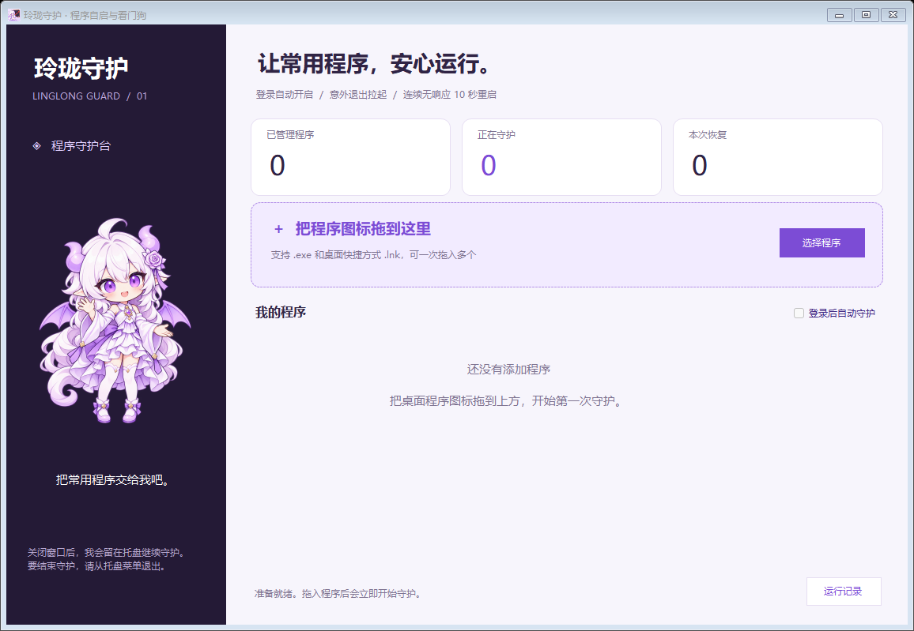

# 玲珑守护 · Windows 版

使用紫色小龙娘「玲珑」主题的 Windows 桌面程序自启与看门狗。Rust 原生守护核心与 C# WinForms 界面，适用于 **Windows 10 / 11 x64**。

**[下载 Windows 1.0.0](https://github.com/shuizhaodemumu/-your-login-startup-items/releases/tag/windows-v1.0.0)** · [发布说明](RELEASE_NOTES_1.0.0.md) · [测试范围](VALIDATION.md)



## 安装与使用

1. 在 Release 中下载 `LinglongGuard-1.0.0-windows-x64.zip`，解压到长期保留的位置。
2. 运行 `LinglongGuard.exe`，保留同目录的 `dragon_guard_core.dll`。无需安装 Rust、Node 或 Python；需要系统自带的 .NET Framework 4.8。
3. 将桌面软件的 `.exe` 或指向它的 `.lnk` 快捷方式拖入窗口，也可以点击“选择程序”。支持一次加入多个程序。
4. **加入后立即启动并守护**。若已经有一个能够明确识别的实例，会直接接管；多个独立实例会提示处理，不随机选择。
5. 勾选“登录后自动守护”开启当前用户的登录自启；每个条目的“登录自启”决定它是否随守护台启动。首次打开空列表不会修改 Windows 自启。

## 看门狗与恢复

- 约每秒检查一次，程序退出后重新启动。
- 连续观测到窗口无响应达到 **10 秒**后，强制结束旧进程再启动；恢复响应会清零卡顿计时，休眠或较长调度间隔不算连续卡顿。
- 保留启动参数、工作目录及主窗口位置、大小、正常/最大化/最小化状态。快捷方式的参数与工作目录会自动导入，也可以在“设置”中修改。
- 使用最近 60 秒的滑动窗口，最多自动重启 5 次；持续失败时暂停并显示原因，处理后点“启动 / 继续”。
- 自己启动的程序通过 Job Object 管理，在重启时清理拥有的残留子进程。接管此前已经运行的程序时仅持有主进程，不强杀未持有的旧子进程。

**未保存文档、编辑内容、标签页、账号会话和内存状态不能通用恢复**，需要目标软件自身的自动保存与会话恢复功能。

正常手动关闭目标程序也会触发重启。需要主动关闭时，请先取消该条目的看门狗。关闭玲珑守护窗口会收起到托盘；托盘菜单支持暂停全部、打开窗口和退出。**退出守护或移除条目不会结束目标程序。**

## 兼容性边界

- 无窗口后台程序只能监测存活；隐藏到托盘、没有可见窗口时，无法靠通用窗口探测判断业务线程是否卡死。
- 暂不支持网页、脚本、商店应用入口、Windows 系统目录中的 EXE，以及同一 EXE 的多份独立管理配置。
- 启动器、自动更新器及启动后转交其他进程的入口不保证兼容，请优先选择实际主程序 EXE。
- 默认使用普通用户权限。守护管理员程序时可能需要以相同权限运行；低权限资源管理器向提权窗口拖放会受 Windows 限制，可改用“选择程序”。普通 Run 登录自启不能替代需要 UAC 同意的提权流程。
- 真实开机登录、跨权限交互、物理鼠标拖放、多显示器热插拔及复杂第三方软件长期兼容性尚未实测，详见 [VALIDATION.md](VALIDATION.md)。

## 数据与卸载

数据保存在 `%LOCALAPPDATA%\LinglongGuard`：`settings.json`、上一份配置备份、损坏配置副本和滚动事件日志。配置包含启动参数，避免在参数中保存密码。

卸载前取消“登录后自动守护”，从托盘退出，再删除程序目录。需要清除管理列表时，再删除上述数据目录。仅使用当前用户 Run 注册表键的 `LinglongGuard` 值，不修改目标软件原有的自启项。若在 Windows 任务管理器里禁用了该启动项，需要自行重新启用。

## 从源码构建

安装 Rust Windows x64 MSVC 工具链及 Visual Studio C++ Build Tools，确保 `cargo` 在 PATH 中；Windows 提供的 .NET Framework C# 编译器用于构建界面。项目没有第三方 crate 依赖。

```powershell
cd windows
.\build.ps1 -Test
.\tests\run.ps1 -SkipBuild
.\tests\ui.ps1
```

生成的程序位于 `windows/bin/`。也支持 `-Target x86_64-pc-windows-gnu`，需自行配置相应 Rust 工具链与链接器。`-Cargo` 可指定 cargo.exe 路径。

测试只操作项目生成的夹具程序与隔离数据，不执行真实注销或系统重启。UI 测试需要可创建窗口的 Windows 桌面会话。

## 项目结构

- `src/lib.rs`：原生进程监测、挂起检测、重启与窗口恢复。
- `ui/`：拖放管理、配置保存、登录自启和托盘界面。
- `assets/`：玲珑的欢迎、守护和修复状态素材。
- `tests/`：原生与界面集成测试夹具。
- `releases/1.0.0/`：已验证的 Windows 二进制包及校验值，供发布工作流使用。

Windows 版与仓库根目录的 Ubuntu GTK4 版使用不同实现和版本号，各自的功能与限制以对应说明为准。
